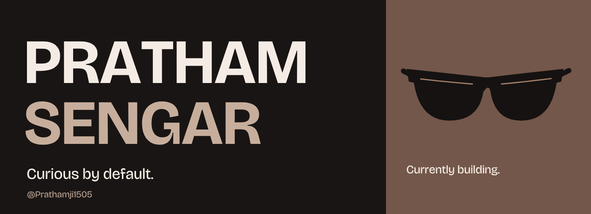

<picture>
  <source media="(max-width: 600px)" srcset="assets/profile-mobile.png">
  
</picture>

## Hey, I’m Pratham.

A curious builder based in **New Delhi, India**. I’m currently developing projects, learning along the way, and paying attention to the details—from the code to the interface.

**[Repositories](https://github.com/Prathamji1505?tab=repositories)** · **[Activity](https://github.com/Prathamji1505?tab=overview#js-contribution-activity)** · **[Things I’m exploring](https://github.com/Prathamji1505?tab=stars)**

### What I care about

- **Clear code.** Structure and names that make the work easier to understand.
- **Thoughtful interfaces.** Useful interactions, readable layouts, and details that feel considered.
- **Steady progress.** Learning by building, testing ideas, and improving the result.

### Right now

I’m focused on building and refining my projects. I’ll share them here as they’re ready.

Learning, building, getting better.
