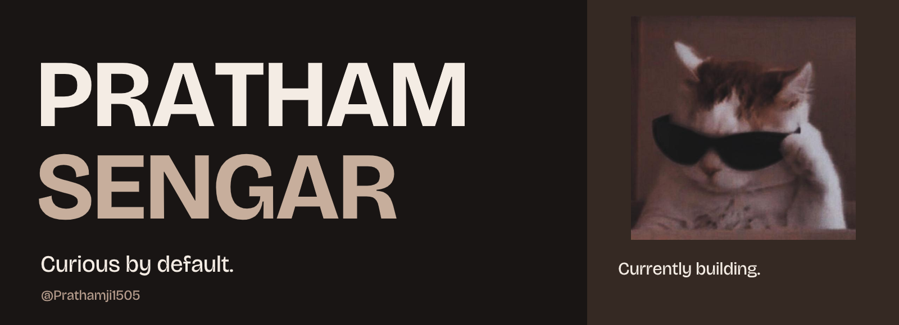

<picture>
  <source media="(max-width: 600px)" srcset="assets/profile-cat-mobile.png">
  
</picture>

## Hey, I’m Pratham.

A curious builder based in **New Delhi, India**. I’m currently developing projects, learning along the way, and paying attention to the details—from the code to the interface.

**[Repositories](https://github.com/Prathamji1505?tab=repositories)** · **[Activity](https://github.com/Prathamji1505?tab=overview#js-contribution-activity)** · **[Things I’m exploring](https://github.com/Prathamji1505?tab=stars)**

### Selected project

<a href="https://github.com/Prathamji1505/sampati">
<picture>
  <source media="(max-width: 600px)" srcset="https://raw.githubusercontent.com/Prathamji1505/sampati/494bc11fdb100b3e06341b6d6e883bfcf838b7b3/docs/images/sampati-project-mobile.svg">
  
</picture>
</a>

**[SAMPATI · सम्पाति](https://github.com/Prathamji1505/sampati)** — An independent civilian disaster-response and relief-coordination application. It connects reviewed flood evidence, confirmed supply needs, aid inventory, shipment records and unmet-needs follow-up.

Structured intake can create auditable drafts under an explicit owner rule. People still confirm needs and source evidence. Built with **React, TypeScript, FastAPI and PostgreSQL**.

[Open full workspace](https://github.com/Prathamji1505/sampati/blob/main/docs/images/remaining-needs.png) · [Product walkthrough](https://github.com/Prathamji1505/sampati/blob/main/docs/REVIEWER_GUIDE.md) · [Source and architecture](https://github.com/Prathamji1505/sampati/blob/main/docs/ARCHITECTURE.md) · [Run locally](https://github.com/Prathamji1505/sampati/blob/main/docs/SETUP.md)

Actual application capture with fictional demo records, 8 November 2026. Local release; public hosting and field validation remain future work. <a href="https://github.com/Prathamji1505/sampati/blob/main/docs/images/README.md">Visual provenance</a>.

### What I care about

- **Clear code.** Structure and names that make the work easier to understand.
- **Thoughtful interfaces.** Useful interactions, readable layouts, and details that feel considered.
- **Steady progress.** Learning by building, testing ideas, and improving the result.

Learning, building, getting better.
